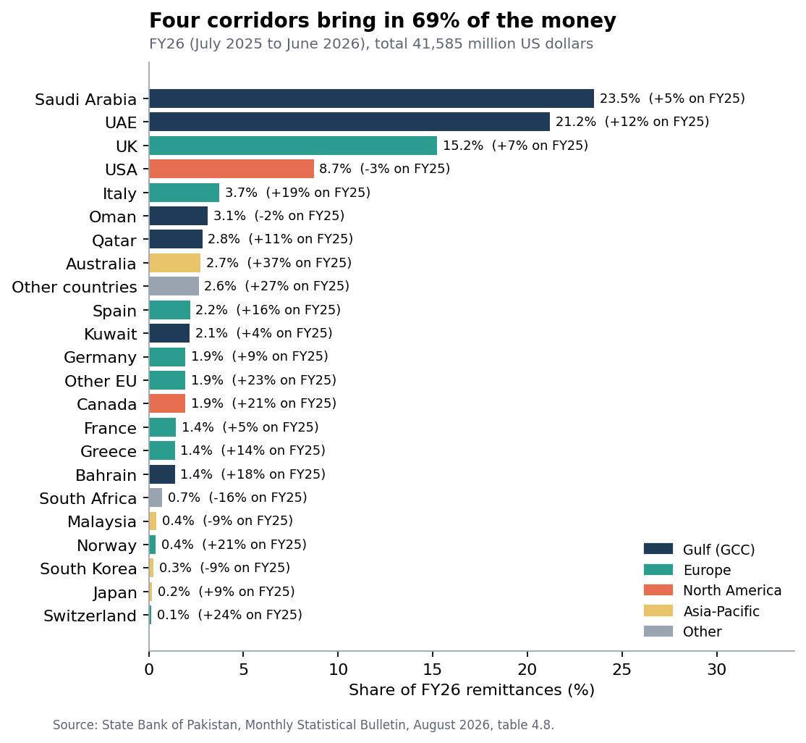
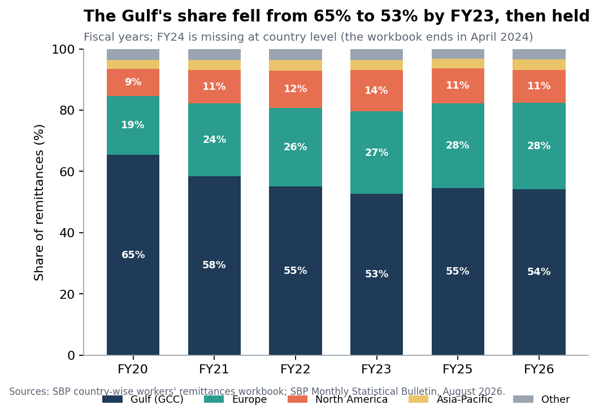
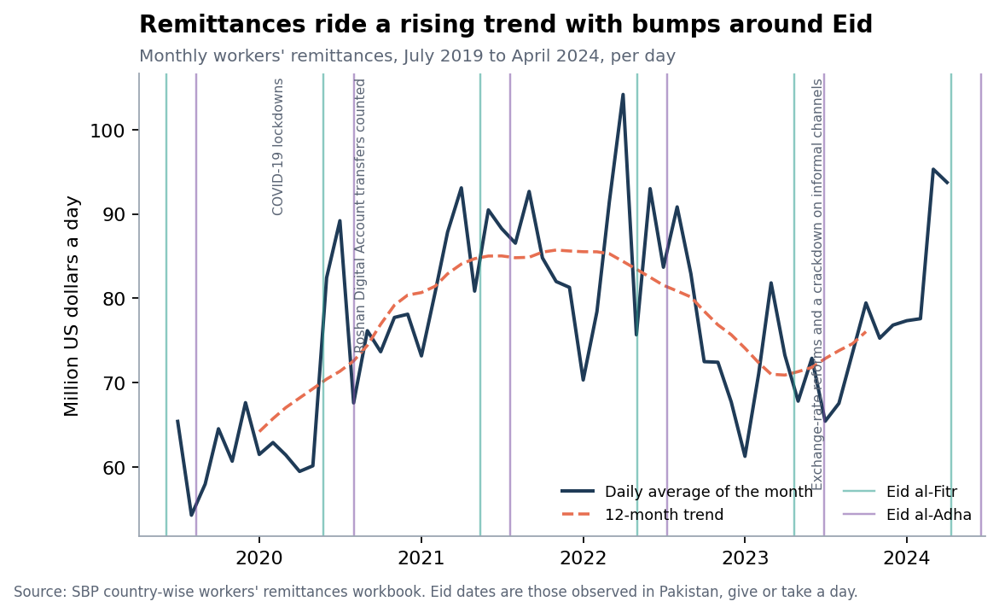
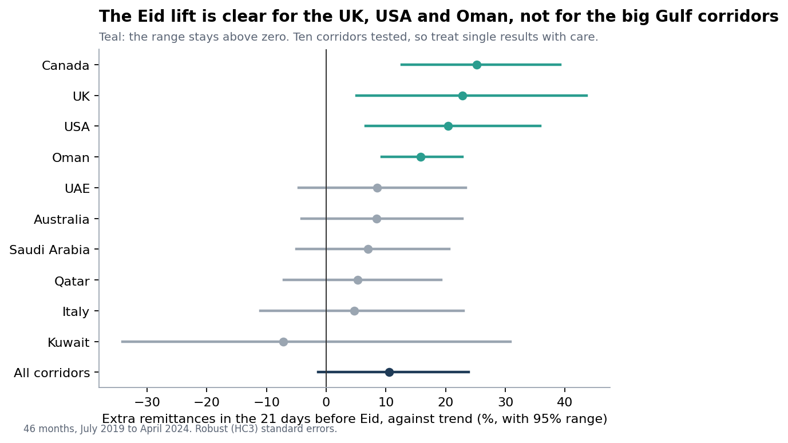

# Pakistan remittance corridors: where the money comes from and when it arrives

[](https://github.com/Maira-W/pakistan-remittance-corridors/actions/workflows/ci.yml)

[](LICENSE)

Overseas Pakistanis sent home **$41.6 billion** in the year to June 2026, about $3.5 billion a month. A bank, fintech or exchange house that wants a share of that money needs two answers: **which countries should it serve first, and when should it be ready for the busiest weeks?** This project answers both from the State Bank of Pakistan's own figures, and says how sure it is.

| | |
|---|---|
| **Interactive dashboard** | [maira-w.github.io/pakistan-remittance-corridors](https://maira-w.github.io/pakistan-remittance-corridors/) (five tabs: the big picture, corridors, when money arrives, where to focus, method) |
| **Recommendation memo** | [`docs/recommendation_memo.md`](docs/recommendation_memo.md) |
| **Method and data** | [methodology](docs/methodology.md) · [data sources](docs/data_sources.md) |
| **Data for Power BI or Excel** | [`data/processed`](data/processed) (plain CSV files) |

## What the data show

1. **The flow is large and growing.** FY26 brought $41.6 billion, +8.6% on FY25 ($38.3 billion). It was $23.1 billion in FY20.
2. **Four corridors carry 69% of it:** Saudi Arabia, UAE, UK and USA. The top three (Saudi Arabia, UAE and UK) bring in 60%.
3. **The Gulf's lead has narrowed, early.** The Gulf states sent 65% in FY20 and 53% in FY23 as Europe and North America gained, and 54% in FY26: the share has been steady since FY23. In FY26 Europe (+11%) and Asia-Pacific (+24%) grew faster than the total (+8.6%), the Gulf slightly slower (+7.8%) and North America hardly at all (+0.9%).
4. **Growth in FY26 came from a few places.** The largest gains in dollars were UAE (+$978 million), Saudi Arabia (+$438 million) and UK (+$421 million). Among single countries outside the core, the fast risers were Italy (+19%), Australia (+37%) and Canada (+21%). The USA (-2.6%) and Oman (-1.7%) shrank.
5. **Money arrives in a wave before Eid, but the wave is modest and uncertain.** In the 21 days before Eid, remittances run about **+10.6%** above trend (95% range -1.3% to +23.9%). That is borderline: 12% of made-up Eid calendars find a lift as large.
6. **The lift is clearest in the UK, USA and Oman.** The UK gains +23%, the USA +20% and Oman +16%, but the two largest corridors do not show a clear lift (Saudi Arabia +7%, UAE +8%, neither distinguishable from zero).
7. **Some calendar months stand out.** In these years March, April, June and July were the strongest months and January, May and December the weakest (only three or four years behind each month, so read this as a pattern to check, not a rule).

<table>
<tr>
<td width="50%"><a href="docs/figures/01_corridor_shares.png"></a><br><sub>Who sends the money, FY26</sub></td>
<td width="50%"><a href="docs/figures/02_region_mix.png"></a><br><sub>The Gulf's share fell, then held</sub></td>
</tr>
<tr>
<td><a href="docs/figures/04_monthly_total.png"></a><br><sub>Monthly remittances and the Eid dates</sub></td>
<td><a href="docs/figures/06_eid_by_corridor.png"></a><br><sub>The Eid lift differs by corridor</sub></td>
</tr>
</table>

All seven figures are in [`docs/figures`](docs/figures).

## What to do with it

- **Serve the core corridors first** (Saudi Arabia, UAE, UK and USA), then the next tier (Italy, Oman, Qatar, Australia, Spain, Kuwait, Germany, Canada, France, Greece and Bahrain).
- **Do not build on the Gulf alone.** It still sends 54%, but its share is down from 65% in FY20 and in FY26 Europe and Asia-Pacific grew faster.
- **Plan capacity and campaigns around Eid**, with the strongest case in the UK, USA and Oman. Treat the size of the lift as a range, not a number.
- **Check it against your own customers.** These are national totals, not one provider's flows.

The [memo](docs/recommendation_memo.md) gives the reasoning and the planning calendar for Eid al-Fitr 2027 and Eid al-Adha 2027.

## How it works

```
data/raw  ──build──▶  data/interim  ──analyze──▶  data/processed  ──report──▶  docs/figures · dashboard/ · docs/
 (checksummed)         (clean, checked)            (results)                    (everything you open)
```

| Stage | What it does |
|---|---|
| `ingest` | Downloads the 2 raw files once and records a SHA-256 checksum, source and date for each in [`data/raw/MANIFEST.json`](data/raw/MANIFEST.json). `verify` checks them. |
| `build` | Reads SBP's monthly workbook (July 2018 to April 2024) and the bulletin's annual table; checks that countries add up to totals and months add up to SBP's own fiscal-year totals. |
| `analyze` | Corridor shares and growth, concentration, a ratio-to-trend seasonal model with Eid windows, a placebo test, tiers and a planning calendar. |
| `report` | Draws the figures, builds the dashboard and writes these documents. |

The documents (including this file) are written from [`remit/templates`](remit/templates) and the results, so a number in the text cannot disagree with the data. Edit the template, not the output.

## Data

| Source | Used for | Vintage |
|---|---|---|
| State Bank of Pakistan, country-wise workers' remittances workbook (Internet Archive copy) | Monthly remittances by country | July 2018 to April 2024 |
| State Bank of Pakistan, Monthly Statistical Bulletin, August 2026, table 4.8 | Annual remittances by country, FY25 and FY26 | to July 2026 |

SBP no longer publishes the workbook at its own address, which is why an archived copy is used. Details and every data problem found are in [`docs/data_sources.md`](docs/data_sources.md).

## Quality checks

- **Everything adds up.** Countries sum to the total, groups sum to their members, and every month sums to SBP's printed fiscal-year totals, or the build stops.
- **Raw files cannot change silently.** Each has a checksum, checked in CI.
- **A placebo test** moves the Eid dates by 9 to 150 days and refits, to show how unusual the real result is.
- **Tests** cover the parsers, the model on a case with a known answer, the documents and the dashboard. They run on every push.

## Limitations

- Monthly country data end in April 2024, so the Eid result rests on 46 months and about nine Eids. FY24 is missing at country level.
- These are remittances through formal channels recorded by the central bank. Informal flows are not counted.
- US dollars only; exchange-rate effects are not modelled.
- The Eid result is borderline for the total, and the corridor results are exploratory (10 were tested).
- Associations, not causes: 2020-03: COVID-19 lockdowns; 2020-09: Roshan Digital Account transfers counted; 2023-07: Exchange-rate reforms and a crackdown on informal channels.

## Reproduce it

```bash
python -m venv .venv && .venv\Scripts\activate        # macOS or Linux: source .venv/bin/activate
pip install -r requirements-dev.txt
python -m remit verify          # raw files match their checksums
python -m remit all             # build, analyze and report (under a minute)
pytest                          # run the tests
```

Outputs are deterministic (seed 42). `python -m remit ingest --refresh` downloads the raw files again, which needs the internet and a patient wait for the State Bank's server.

## Layout

```
remit/             the package: ingest, build, analysis, charts, dashboard, docs
  templates/       dashboard page and document templates
data/raw/          source files and MANIFEST.json (checksums)
data/interim/      cleaned tables
data/processed/    results as CSV and JSON
docs/              memo, methodology, data sources, figures
dashboard/         the interactive dashboard (one HTML file)
tests/             pytest suite
.github/workflows/ continuous integration
```

## Licence

The code and documents are released under the [MIT licence](LICENSE). The data are State Bank of Pakistan statistics; see [`docs/data_sources.md`](docs/data_sources.md).
